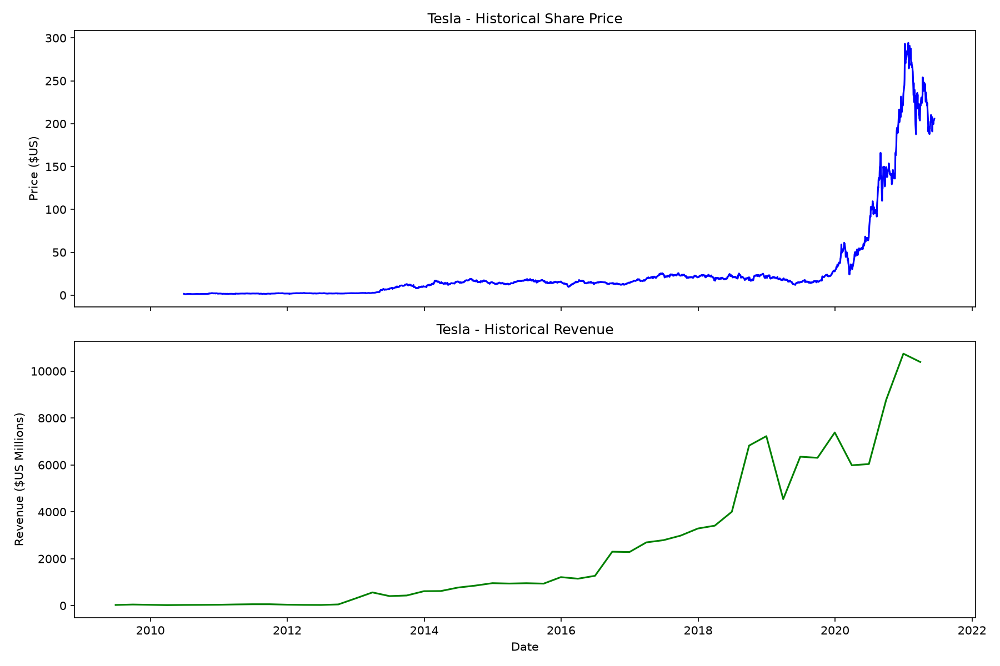
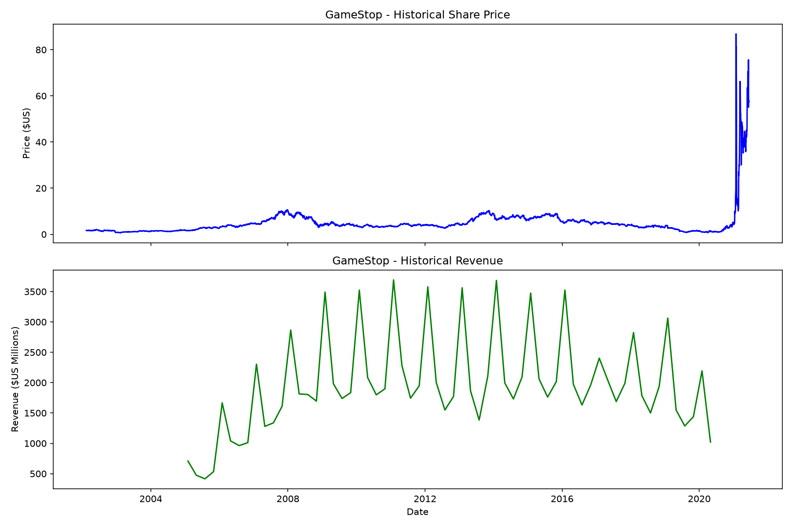

# Tesla & GameStop: Stock Price vs. Revenue Analysis

A Python project that extracts historical stock prices and quarterly revenue for Tesla (TSLA) and GameStop (GME), cleans the data, and visualizes both side by side.

## Results

### Tesla



### GameStop



## What it does

- Downloads full historical share-price data with `yfinance`
- Scrapes quarterly revenue tables from HTML pages using `BeautifulSoup`
- Cleans the data with `pandas` (removes `$` and `,` characters, drops empty rows)
- Exports the cleaned data as CSV files
- Plots share price and revenue over time with `matplotlib` and saves the charts as PNG files

## Tech stack

Python, pandas, yfinance, requests, BeautifulSoup, matplotlib

## Getting started

```bash
git clone https://github.com/parsaasaber/tesla-gamestop-stock-analysis.git
cd tesla-gamestop-stock-analysis
python -m venv venv
source venv/bin/activate      # Windows: venv\Scripts\activate
pip install -r requirements.txt
python main.py
```

Running the script saves the CSV files to `data/` and the charts to `charts/`, then displays the charts.

## Project structure

```
├── main.py             # data extraction, cleaning, plotting
├── requirements.txt    # dependencies
├── data/               # exported CSVs (stock prices and revenue)
├── charts/             # generated PNG charts
└── README.md
```

## Data sources

- **Stock prices:** Yahoo Finance via `yfinance`
- **Revenue:** static HTML pages provided by the IBM Data Analysis with Python course (Coursera)

## Notes

- Share price is plotted up to 2021-06-14 and revenue up to 2021-04-30 to match the course project's reporting window.
- Interactive Plotly charts were replaced with static Matplotlib ones for easier submission.
- Stock data is fetched live from Yahoo Finance, so results may differ slightly depending on when you run the script.

## Author

Parsa, [@parsaasaber](https://github.com/parsaasaber)